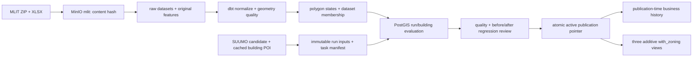

# MLIT zoning local: nguồn có phiên bản, matching và publication

Phạm vi đầu tiên: Osaka-fu `27`, Osaka-shi `27100`. Các bảng/view SUUMO hiện có giữ giao diện và grain; ba view `*_with_zoning` là output bổ sung. `用途地域`, `far_pct`, `bcr_pct` là giá trị chỉ định trên polygon MLIT. Chúng chưa bao gồm giới hạn riêng của lô đất, điều kiện đường tiếp giáp hoặc các ngoại lệ pháp lý. Tọa độ là POI của provider đã matching theo tên/địa chỉ, chưa xác minh độc lập mái tòa.

## Luồng và grain



- `raw.mlit_datasets`: một snapshot theo tỉnh/thành phố + SHA256 ZIP + hash metadata của thành phố. Metadata workbook toàn quốc có SHA riêng. Release date/content ID không quyết định khóa.
- `raw.mlit_zoning_polygons`: feature nguyên bản theo dataset/file/ordinal. Không sửa geometry và properties.
- `raw.mlit_source_checks`: audit từng lần tải, gồm URL và manifest của lần kiểm tra; cùng nội dung vẫn có audit mới, không nhân dataset.
- `enrichment.zoning_runs`: dataset/rule/input fingerprint; một evaluation tái dùng nếu tất cả không đổi. `zoning_run_inputs` và `zoning_run_tasks` bất biến. Fingerprint bao gồm danh sách task, nên batch mới tạo snapshot DS mới ngay cả khi tọa độ không đổi.
- `intermediate.int_mlit__polygon_states`: append-only polygon canonical hash theo city, `ST_Normalize` EWKB và zoning/FAR/BCR. Không simplify/snap geometry. GiST trên `geom`. Core views dùng materialization `mlit_stable_view` (CREATE OR REPLACE) để refresh không DROP CASCADE các view đang phục vụ.
- `mart.dim_zoning_area`: view của các polygon chuẩn hóa hợp lệ; cùng content tái dùng key giữa dataset.
- `intermediate.int_mlit__dataset_areas`: quan hệ dataset–polygon, source file/ordinal và các mốc nguồn riêng.
- `intermediate.int_mlit__zoning_matches`: append-only, một run/building; giữ toàn bộ candidate evidence, trạng thái/lý do và khoảng cách. `full_refresh=false`; trigger từ chối UPDATE/DELETE.
- `intermediate.int_mlit__published_results`: chỉ những run đã công bố; overlay quyết định `accepted_null` từ audit, không sửa spatial result.
- `mart.bridge_building_zoning`: view rút gọn trạng thái liên tiếp giống nhau. Đây là quan hệ theo thời gian, không phải bridge đa trị chấp nhận đồng thời nhiều vùng.

Không thêm quy hoạch vào `building_attributes`, `listing_attributes` hoặc hash SCD2. `geography_key`, `building_key`, các khóa phiên bản và fact không thay đổi.

## Matching và NULL

MLIT geometry dùng EPSG:6668 (JGD2011); điểm provider EPSG:4326 chuyển bằng `ST_Transform`. `ST_Covers` kiểm tra trong/trên ranh; khoảng cách tới `ST_Boundary` tính trong EPSG:6674 theo mét. Cặp tọa độ phải thuộc phạm vi Nhật, provider status `matched`, level `building_poi`. Không fallback sang chōme.

Loại polygon trùng canonical geometry + normalized business attributes trong cùng dataset. Một vùng và cách ranh **ít nhất 10 m**: `matched`. Dưới 10 m: `near_boundary`; nhiều vùng khác nhau: `ambiguous`; không có vùng: `not_found`; thiếu điểm hợp lệ: `no_valid_location`. Các trạng thái không matched trả zoning/FAR/BCR NULL, giữ candidates JSON để đối chiếu.

Numeric FAR/BCR được NFKC và parse sang phần trăm (400 = 400%, không phải 4). NULL/chuỗi rỗng giữ NULL; giá trị sai được gắn `invalid_numeric` và không công bố candidate dataset. Geometry lỗi giữ raw nhưng không auto-repair hoặc cho phép override.

`source_as_of_date` lấy mốc đầu tiên trong cột AI của metadata thành phố cho lớp zoning; giữ cả row gốc vì ghi chú có thể đề cập lớp khác. `INDate` dạng ISO được lưu riêng là `source_effective_date`; không suy diễn ngày hiệu lực từ fiscal year/release/download. Nguồn hiện có fiscal year 2025, Osaka metadata 2024-08-23; không gọi đây là quy hoạch pháp lý của năm crawl.

## Phiên bản nghiệp vụ và công bố

Chữ ký gồm status, zoning code/name, FAR, BCR; không gồm dataset/run, ngày tải, polygon key hoặc khoảng cách. Dataset mới không đổi thuộc tính giữ phiên bản. A → B → A tạo ba phiên bản. Version key là building + run đầu tiên của đoạn trạng thái. `valid_from/to` là thời điểm warehouse công bố, không phải ngày quy hoạch có hiệu lực. `is_current` chỉ phiên bản cuối của lịch sử công bố; rollback có thể kích hoạt một publication trước đó, output join theo sequence của publication đó.

Một pointer cho Osaka chỉ đổi trong transaction sau chất lượng và kiểm thử. Output luôn đọc một publication; không carry-forward giá trị từ dataset trước vào dataset mới. Khi tòa đã matched bị mất match hoặc mất zoning/FAR/BCR đã biết, run chuyển `blocked`, publication cũ tiếp tục phục vụ. Review JSON chứa before/after.

Quyết định thủ công phải nêu đúng run, toàn bộ building bị suy giảm và lý do. Chấp nhận NULL tạo trạng thái nghiệp vụ `accepted_null`, tất cả zoning/FAR/BCR NULL, giữ spatial evidence. Không vượt qua geometry/structural/integrity errors. Rollback đổi pointer và lưu audit, không xóa run/history.

Output có `stale_location` và NULL nếu fingerprint của điểm đang dùng khác snapshot (tọa độ/provider/Place ID/status/level). Tòa mới chưa có trong publication: `no_snapshot_input`; chưa công bố: `no_publication`. Listing không tên không được gán ngược sang named building.

## Vận hành local

DAG `mlit_zoning_refresh`: thứ Hai 03:00 Asia/Tokyo, `catchup=false`, `max_active_runs=1`, một writer. `refresh_source` tải ZIP một lần mỗi check, kể cả content ID không đổi, so SHA; tải workbook và archive cùng manifest vào bucket `mlit`. `reuse_source` không HTTP tới MLIT.

SUUMO dựng `int_suumo__zoning_inputs` và vượt input quality gates rồi trigger MLIT `reuse_source`, chờ hoàn tất trước đọc publication. Analytics-only tái dùng publication. Các model `mlit_zoning_core` trong Cosmos SUUMO là reused relations, không có dbt run writer; root core chỉ chạy qua MLIT DAG. Nhánh `dim_building`, staging vị trí, lookup candidates hoặc zoning inputs đều trigger reuse_source sau input gates. `int_suumo__zoning_inputs` là view đọc cache hiện tại để phát hiện stale_location ngay khi điểm đổi. No-batch giữ skip; weekly DAG độc lập.

Input view cũng dùng `mlit_stable_view` để không xóa các output phụ thuộc khi dbt dựng lại. Quality gates đi vào `prepare_zoning_refresh` với `NONE_FAILED`: test của nhánh không được chọn có thể skip; test thất bại vẫn chặn. Trigger chỉ phụ thuộc chooser với `ALL_SUCCESS`, nên analytics/no-batch không kích hoạt MLIT.

Lần bootstrap mới phải build core/output trước khi SUUMO kiểm tra reused relations:

```sh
make -C pipeline build
make -C pipeline mlit-init
make -C pipeline dbt-build select="int_suumo__zoning_inputs tag:mlit_zoning_core tag:mlit_zoning_output"
make -C pipeline dbt-airflow-manifest
make -C pipeline mlit-refresh opts="--dry-run"
```

Dry-run không HTTP/DDL/MinIO/DB; `--init-only` chỉ tạo bảng/extension; `--force-download` nói rõ ý định tải lại (refresh luôn tải để kiểm tra SHA, nên không có shortcut content-ID). Scope khác 27/27100 bị từ chối trong bản đầu.

Sau raw refresh, chạy DAG với `{"mode":"reuse_source"}` hoặc `{"mode":"refresh_source"}`. DAG lưu dbt artifacts riêng tại `target/mlit_runs/<run_id>`; XCom chỉ có khóa/số lượng, không chứa raw polygons hay review JSON.

```sh
make -C pipeline mlit-publication opts="check --run-id RUN_ID"
make -C pipeline mlit-publication opts="publish --run-id RUN_ID --accept-null BUILDING_KEY --reason 'Đã đối chiếu lý do cụ thể'"
make -C pipeline mlit-publication opts="rollback --run-id PREVIOUS_RUN_ID --reason 'Lý do rollback'"
make -C pipeline mlit-publication opts="export --run-id RUN_ID --output /opt/airflow/dbt/target/mlit_zoning/ds_export"
make -C pipeline mlit-test
make -C pipeline mlit-verify
```

Export chỉ nhận run đã công bố. Nó ghép **cố định run/building** và task manifest của snapshot; xuất observations, inputs, matches, tasks và manifest SHA256. Không phụ thuộc pointer hiện tại và không áp `stale_location` của điểm thay đổi sau publication. Manifest giữ dataset/hash/rule và mốc dữ liệu. Đây là enrichment theo snapshot được công bố, không phải zoning vào ngày từng observation.

`mlit-verify` còn đọc object MinIO để đối chiếu SHA256 ZIP/XLSX/manifest, kiểm tra GiST và audit lần nguồn được tải lại. Kết quả lưu `storage_verification.json`; không ghi warehouse hoặc gọi MLIT. Manifest bootstrap cũ giữ nguyên ở đường dẫn dataset hash; các lần kiểm tra sau dùng tên file manifest hash và được truy vết qua `raw.mlit_source_checks`.

Backup trước migration ở `pipeline/warehouse/backups/mlit_20261010` (gitignored): cả warehouse và Airflow metadata dạng custom dump; kiểm tra bằng `pg_restore --list`. Image dùng base PostgreSQL16.3 pinned digest, hold server packages khi cài PostGIS; không đổi PGDATA/locale/database/volume. Package/version/image ID/digest thực tế và coverage ở `analytics/dbt/target/mlit_zoning`. Restore chỉ thực hiện sau quyết định phục hồi rõ ràng, không dùng `clean-volumes`.

## Kiểm thử

`test_mlit_zoning.py`: discovery đổi URL, content đổi cùng ngày, metadata hash, retry, ZIP corruption/traversal/symlink, scope và dry-run. `integration_mlit_zoning.py` chạy compiled production matching trên PostGIS trong transaction rollback: trong/ngoài/trên ranh, dưới/đúng/trên 10 m, polygon duplicate/overlap, đảo tọa độ và CRS; publication unchanged/A-B-A/hold/explicit NULL/rollback/immutable/invalid geometry. Các test DAG kiểm tra ownership, no-cycle, schedule, dbt_only/analytics selection và no-batch từ suite SUUMO. Baseline verifier kiểm tra facts, listing/building versions, geography, raw hashes, price history và tất cả cột/grain trong view mới.

`integration_mlit_zoning_trigger.py` là kiểm thử vận hành riêng: scheduler chạy, DAG SUUMO tạm pause, MLIT unpause. Chạy nhánh `dbt_only/int_suumo__zoning_inputs`, assert task trigger **success**, tìm child run qua XCom và assert child **success**, mode `reuse_source`. Xuất `trigger_evidence.json`; không chỉ dựa vào trạng thái tổng của DAG. Sau kiểm thử phải khôi phục trạng thái pause ban đầu của SUUMO.

## Căn cứ từ ba Markdown

Số trang là trang sách được mục lục Markdown ghi, không phải trang Markdown:

| Tài liệu và mục                                                                                                                                                                                 | Trang sách | Áp dụng                                                     |
| ----------------------------------------------------------------------------------------------------------------------------------------------------------------------------------------------- | ---------: | ----------------------------------------------------------- |
| [Chương 1, 10.2–10.3](/Users/hoangvinh/Library/CloudStorage/OneDrive-Personal/Workspace/data_engineer_docs/warehouse_toolkit_3th/chuong-01-nhap-mon-dw-bi-va-mo-hinh-hoa-chieu.md:524)          |      19–21 | Tách raw/audit/ETL khỏi presentation                        |
| [Chương 2, 34](/Users/hoangvinh/Library/CloudStorage/OneDrive-Personal/Workspace/data_engineer_docs/warehouse_toolkit_3th/chuong-02-tong-quan-ky-thuat-mo-hinh-hoa-chieu-kimball.md:811)        |         54 | Phiên bản chỉ đổi khi thuộc tính nghiệp vụ đổi              |
| [Chương 2, 55 và 57](/Users/hoangvinh/Library/CloudStorage/OneDrive-Personal/Workspace/data_engineer_docs/warehouse_toolkit_3th/chuong-02-tong-quan-ky-thuat-mo-hinh-hoa-chieu-kimball.md:1108) |         62 | Rút gọn trạng thái, tránh outrigger làm phình SCD2 building |
| [Chương 2, 70 và 74](/Users/hoangvinh/Library/CloudStorage/OneDrive-Personal/Workspace/data_engineer_docs/warehouse_toolkit_3th/chuong-02-tong-quan-ky-thuat-mo-hinh-hoa-chieu-kimball.md:1290) |     66, 68 | Audit nguồn/rule/run và error events trước/sau              |
| [Chương 3, 3–4](/Users/hoangvinh/Library/CloudStorage/OneDrive-Personal/Workspace/data_engineer_docs/warehouse_toolkit_3th/chuong-03-ban-le-retail-sales.md:133)                                |      71–72 | Grain observation phải giữ nguyên                           |
| [Chương 3, 33](/Users/hoangvinh/Library/CloudStorage/OneDrive-Personal/Workspace/data_engineer_docs/warehouse_toolkit_3th/chuong-03-ban-le-retail-sales.md:1161)                                |        104 | Giấu nhiều join sau view phẳng phục vụ phân tích            |

Các file gốc trong `../data_engineer_docs/warehouse_toolkit_3th/`: `chuong-01-nhap-mon-dw-bi-va-mo-hinh-hoa-chieu.md` (mục10.2 line524), `chuong-02-tong-quan-ky-thuat-mo-hinh-hoa-chieu-kimball.md` (mục34 line811,55 line1108,70 line1290,74 line1361), `chuong-03-ban-le-retail-sales.md` (grain line133; presentation mục33 line1161). Tên bridge không có nghĩa là bridge đa trị theo mục58–59. Ngưỡng10m, weekly schedule và giữ publication cũ là quyết định project; sách không chỉ định các giá trị đó.

Nguồn: [MLIT download](https://www.mlit.go.jp/toshi/tosiko/toshi_tosiko_tk_000182.html), [MLIT metadata](https://www.mlit.go.jp/toshi/tosiko/toshi_tosiko_tk_000087.html), [upstream MIT converter](https://github.com/shiwaku/mlit-urban-planning-converter/tree/b7cae65868abaf90f2c89e609ea5ed2ef466882e), [ST_Covers](https://postgis.net/docs/ST_Covers.html), [ST_Transform](https://postgis.net/docs/ST_Transform.html), [ST_Distance](https://postgis.net/docs/ST_Distance.html).
